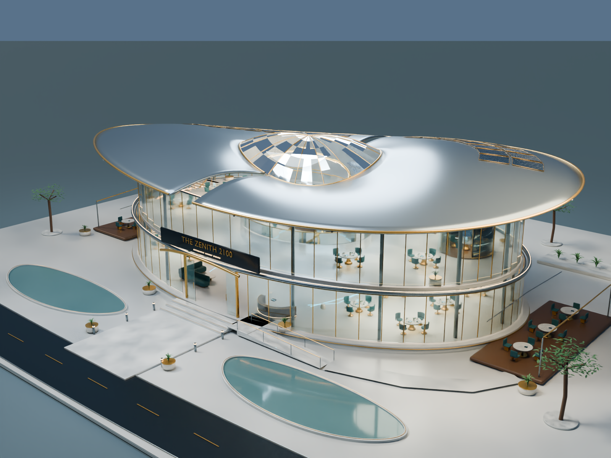

# The Zenith 2100 – Futuristic Luxury Restaurant

مجسم معماري حقيقي قابل للتعديل داخل Blender 4.3 أو أحدث، مع صور الرندر والسكربتات والمخططات ووثائق التصميم.

## التحميل

- **[تحميل حزمة المشروع كاملة ZIP](The_Zenith_2100_Deliverables.zip?raw=true)** — نحو17MB. عند فتح صفحة الملف اضغط **Download raw file**.
- **[تحميل ملف Blender مباشرة](Zenith2100.blend?raw=true)** — نحو11MB.

بعد تنزيل ZIP، فك الضغط وافتح `The_Zenith_2100/Zenith2100.blend` داخل Blender. الصور التسع في `renders`، ويمكن فتح `renders/gallery.html` لمشاهدتها. السكربتات في `scripts`، والمخططات والشرح في `docs`، ونسخةOBJ/MTLفي `exports`.

يضم التصميم مستويين،96مقعدًا تصوريًا، غرفتي طعام خاص، مطبخًا وخدمات، استقبالًا وسلالم ومصعدًا، سقفًا منحنيًا وزجاجًا وتيتانيوم وتفاصيل ذهبية وحدائق وطاولات ذكية وروبوتات تقديم. أعيد فتح الملف واختباره، وفُحصت الفتحات والبسطات والصور وسلامةZIP. بصمات الملفات في [SHA256SUMS.txt](SHA256SUMS.txt).

هذا نموذج جامعي تصوري قابل للتطوير؛ الانتقال للتنفيذ يتطلب مراجعات الإنشاء والخدمات ومطابقة الكود. أداة التنقية الخارجية المحمولة والملفات الخام الكبيرة ليست مطلوبة لفتح المجسم، ولذلك لا تتضمنها حزمة التحميل.

